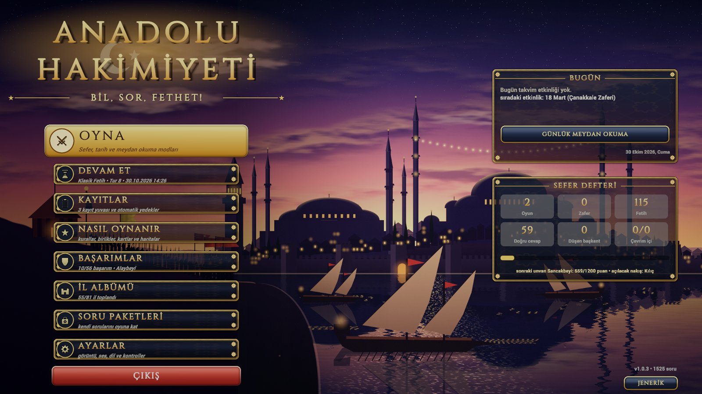
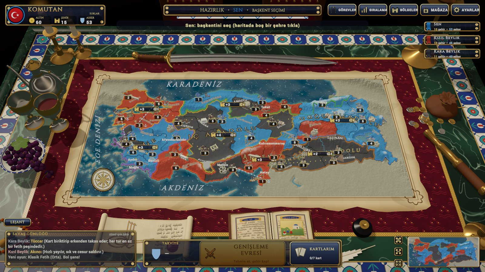
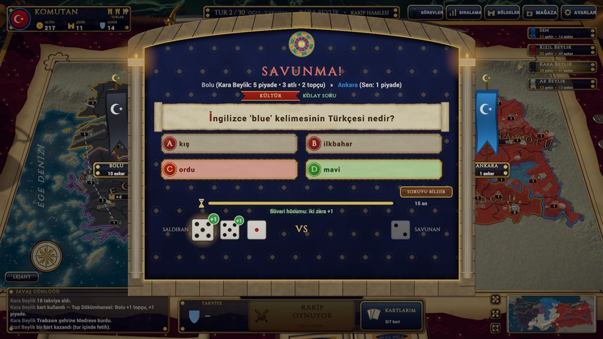
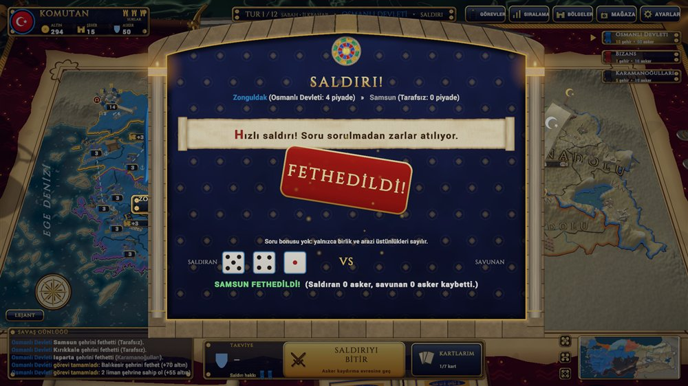
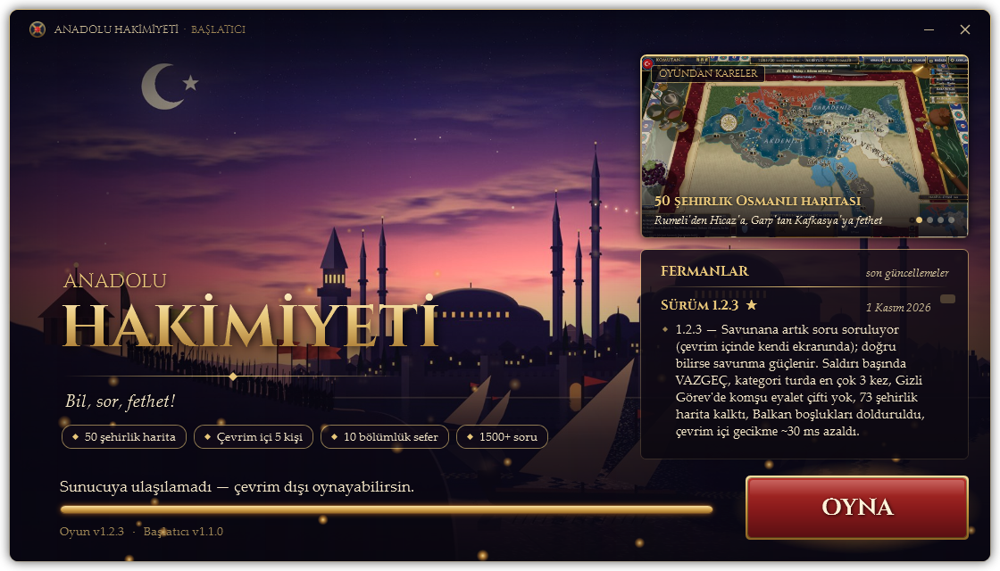

<p align="center">
  
</p>

<h1 align="center">Anadolu Hakimiyeti</h1>
<p align="center"><b>Bil, sor, fethet!</b><br>Türkiye ve Osmanlı haritasında geçen, bilgi yarışmasıyla savaşılan bir strateji oyunu.</p>

<p align="center">
  <a href="https://github.com/sayklord/anadolu-hakimiyeti-surumler/releases/latest/download/AnadoluHakimiyeti_Kurulum.exe"><b>⬇️ Windows için indir</b></a>
  &nbsp;•&nbsp;
  <a href="https://github.com/sayklord/anadolu-hakimiyeti-surumler/releases/latest/download/AnadoluHakimiyeti_Mac.zip"><b>⬇️ Mac için indir</b></a>
  &nbsp;•&nbsp;
  <a href="https://github.com/sayklord/anadolu-hakimiyeti-surumler/releases">Sürüm notları</a>
</p>

---

## Oyun nedir?

Anadolu Hakimiyeti, klasik "dünyayı fethet" masa oyunlarının stratejisini bir **bilgi yarışmasıyla** birleştirir. Haritada şehir şehir ilerlersin, ama her savaşta zarlardan önce bir **soru** gelir: doğru bilirsen ordun güçlenir, bilemezsen rakibin öne geçer. Coğrafya, tarih, kültür, plaka, yöresel yemekler, ünlü yapılar… Türkiye'yi ne kadar iyi tanırsan o kadar çok toprak kazanırsın.

Oyun bir **komuta masasında** geçer: yeşil mermer masa, İznik çinileri, bordo kadife örtü, şamdanlar, Osmanlı kılıcı ve tuğralı fermanlar arasında, parşömen bir harita üzerinde savaşırsın.

<p align="center"></p>

## Nasıl oynanır?

Her tur üç evreden oluşur:

1. **Takviye** — Her tur yeni asker hakkı kazanırsın (şehir sayına ve tuttuğun bölgelere göre). Bunları şehirlerine yerleştirirsin.
2. **Saldırı** — En az 2 askerli bir şehrinden komşu düşman şehrine saldırırsın. Savaş penceresinde önce soru, sonra zarlar gelir. Her tur 2 saldırı hakkın vardır; fethettiğin her şehir hakkını geri verir.
3. **Kaydırma** — Turu bitirmeden önce askerlerini komşu şehirlerine kaydırabilirsin.

Bir bölgenin bütün şehirlerini tutarsan her tur ek asker alırsın. Rakibinin **başkentini** düşürmek için önce **surlarını** kuşatmayla yıkman gerekir.

<p align="center"></p>

### Birlikler
| Birlik | Takviye bedeli | Özelliği |
|---|---|---|
| **Piyade** | 1 hak | Temel asker; 3 ve üstü piyade "mızrak duvarı" kurar, atlıyı durdurur |
| **Atlı** | 2 hak | Saldırıda +1 zar; dağda ve mızrak duvarına karşı işe yaramaz |
| **Topçu** | 3 hak | Savunmada +1 zar; kuşatmada sur yıkar, başkent bonusunu kırar |

Altınla asker alınmaz. Altın; jokerlere (50:50, +10 saniye, 2. şans), şehir yapılarına (medrese, kervansaray, burç) ve casusa harcanır.

### Soru türleri
- **1.300'den fazla çoktan seçmeli** ve **200'den fazla tahmin sorusu** (sayıyı en yakın tahmin eden kazanır)
- Saldırdığın **şehre özel sorular**: ünlü yapısı, yemeği, tarihi
- **Haritada bul**, **sıralama**, **il silüeti** soruları
- **Sesli sorular**: yöre havasını dinle, hangi yöreye ait olduğunu bil (horon, zeybek, halay, bozlak…)
- Kendi soru paketini yükleyebilirsin (öğretmenler için "yalnız paket soruları" seçeneği)

<p align="center"></p>

## Oyun modları

| Mod | Açıklama |
|---|---|
| **Klasik Fetih** | Bütün Türkiye haritasında, yapay zekâ beyliklere karşı tam bir sefer |
| **81 İl** | 81 ilin tamamıyla uzun ve ayrıntılı savaşlar |
| **Hızlı Oyun** | Kısa soru süresi, güçlü başlangıç orduları; yarım saatte biter |
| **Arkadaşlarla** | Aynı bilgisayarda 2–6 kişi sırayla oynar |
| **Gizli Görev** | Büyük Osmanlı haritasında herkese Risk gibi gizli bir görev (bir beyliği yok et, iki eyaleti fethet...); ilk bitiren kazanır |
| **Kampanya** | 1071 Malazgirt, 1299 Beylikten Devlete, 1453 İstanbul'un Fethi — özel hedefler ve yıldızlar |
| **Tarihî Osmanlı Haritası** | Rumeli'den Hicaz'a 8 bölge, 59 şehir; istediğin bölgeleri seçerek oyna |
| **Günlük Meydan Okuma** | Herkese aynı gün aynı harita ve aynı sorular; skorunu geliştir |
| **Bilgi Düellosu** | Haritasız, 10 soruluk kapışma; yapay zekâya, arkadaşına ya da **çevrim içi** oda koduyla uzaktaki arkadaşına karşı |
| **Öğretici** | Oyunu adım adım, okla gösterilen görevlerle öğren |

## Daha fazlası
- **Yapay zekâ kişilikleri**: Akıncı, Kaleci, Tüccar, Fırsatçı ve Dengeli beylikler farklı oynar; öne geçene karşı birleşirler
- **Kartlar**: 20'den fazla kart (Piri Reis, Kahraman Komutan, Barış Elçisi…), set takası
- **Komutanlar**, **diplomasi** (ittifak, haraç, ihanet), **mevsimler** (kışın karlı geçitler), **olay kartları** (bereket yılı, fırtına, kıtlık)
- **Ticaret yolları**: İpek Yolu, Kral Yolu, Baharat Yolu… tamamını tutana her tur altın
- **81 İl Albümü**: fethettiğin her il albüme eklenir, "Biliyor muydun?" bilgileriyle
- **56 başarım**, unvanlar (Nefer'den Sadrazam'a) ve unvanla açılan sancak nakışları
- **Takvim etkinlikleri**: 18 Mart, 23 Nisan, 19 Mayıs, 29 Mayıs, 30 Ağustos, 29 Ekim'de o güne özel sorular ve rozetler
- Maç sonunda **sefer özeti**: tur tur şehir grafiği, kategori başarın, öne çıkan anlar
- **Türkçe ve İngilizce** dil desteği, renk körü desenleri, 3 kayıt yuvası ve otomatik yedek

---

## Kurulum

### Windows
1. **[AnadoluHakimiyeti_Kurulum.exe](https://github.com/sayklord/anadolu-hakimiyeti-surumler/releases/latest/download/AnadoluHakimiyeti_Kurulum.exe)** dosyasını indir ve çalıştır.
2. Windows "Windows kişisel bilgisayarınızı korudu" derse **Ek bilgi → Yine de çalıştır**'a bas.
3. Kurulum bitince masaüstündeki **Anadolu Hakimiyeti** simgesiyle aç.

Oyunu her zaman masaüstündeki simgeden aç: **başlatıcı** yeni sürümü kendiliğinden indirir, yalnız değişen dosyalar iner.

<p align="center"></p>

### Mac
1. **[AnadoluHakimiyeti_Mac.zip](https://github.com/sayklord/anadolu-hakimiyeti-surumler/releases/latest/download/AnadoluHakimiyeti_Mac.zip)** dosyasını indir ve aç; çıkan **Anadolu Hakimiyeti** uygulamasını **Uygulamalar** (Applications) klasörüne sürükle.
2. Mac, internetten inen imzasız oyunları ilk açılışta engeller ("hasarlı" ya da "açılamıyor" der). Bir kereliğine **Terminal**'i aç, şunu yapıştırıp Enter'a bas:
   ```
   xattr -cr "/Applications/Anadolu Hakimiyeti.app"
   ```
3. Artık oyunu Launchpad'den ya da Dock'tan normal açabilirsin; bu adımlar yalnız ilk kurulumda gerekir.

Uygulama İndirilenler klasöründe kaldıysa (2. adımdaki komut "No such file" derse) şu tek satır onu bulup Uygulamalar'a taşır, engeli kaldırır ve açar:
```
APP=$(find ~/Downloads ~/Desktop -maxdepth 3 -name "Anadolu Hakimiyeti.app" -print -quit); mv "$APP" /Applications/ && xattr -cr "/Applications/Anadolu Hakimiyeti.app" && open "/Applications/Anadolu Hakimiyeti.app"
```

**Güncellemeler:** yeni sürüm çıkınca ana menüde **YENİ SÜRÜM — GÜNCELLE** düğmesi belirir; oyun yeni sürümü kendisi indirip kurar ve yeniden açılır. (v1.0.2'den v1.0.3'e geçerken bir kereliğine yeni paketi elle kurman gerekir.)

**Sistem gereksinimi:** Windows 10/11 (64 bit) ya da macOS 12 ve üstü (Intel ve Apple Silicon). Kayıtların güncellemede silinmez.

---

## Geliştirme süreci

Oyun **Unity 6** ile geliştiriliyor. Sahne boştur: harita, arayüz, 3B şehirler, komuta masası ve efektlerin hepsi kodla kurulur. Harita gerçek il sınırlarından (Natural Earth verisi) üretilir; arayüz dokuları, ikonlar ve menü resmi de kodla çizilir.

### Yol haritası

**v0.3 – v0.4 · Temel**
Gerçek il sınırlarıyla kabartmalı harita, Risk tarzı zar savaşları, soru bankası, ilk yapay zekâ. Kart sistemi ve birlik türleri (piyade, atlı, topçu) eklendi. Önemli karar: **altınla asker alınmaz**; askerler yalnız takviye hakkıyla gelir.

**v0.5 · Derinlik**
Birlik üçgeni (atlı topçuyu bastırır, topçu suru yıkar, piyade mızrak duvarı kurar). Soru bankası 1.320 çoktan seçmeli + 205 tahmin sorusuna çıktı, plaka/bölge/matematik soruları kendiliğinden üretilmeye başladı. Yapay zekâ kişilikleri, 41 başarım, unvanlar, öğretici ve ayarlar menüsü.

**v0.6 · Görünüm ve ses**
Şehirler gerçek 3B modellere dönüştü (köy, kasaba, kale, kubbeli başkent sarayı). Soru ekranı orta çağ havasına büründü: sivri taş kemerler, vitraylı gül pencere, kandiller, parşömen tomarı. Kevin MacLeod'un müzikleri, fetih mührü ve görkemli zafer ekranı.

**v0.7 · Yeni modlar**
Kampanya (Malazgirt, Beylikten Devlete, İstanbul'un Fethi), Görev Yarışı, Günlük Meydan Okuma, Bilgi Düellosu. Haritada bul / sıralama / silüet soruları, 81 İl Albümü, şehir yapıları, komutanlar, diplomasi, mevsimler ve limanlarda gemiler.

**v0.8 · Osmanlı ve çevrim içi**
Rumeli'den Hicaz'a Tarihî Osmanlı haritası, ticaret yolları, sesli yöre havası soruları, takvim etkinlikleri, kendi soru paketini yükleme ve Unity Relay ile **çevrim içi bilgi düellosu**.

**v1.0 · İlk tam sürüm**
Komuta masası sahnesi, CK3/EU4 tarzı kavisli harita yazıları, yöreye göre şehir mimarisi ve 60 şehirde ünlü yapı. 6 tarafa kadar oyun, 3 kayıt yuvası, maç sonu sefer özeti, yeni ana menü ve **İngilizce dil desteği**. Bütün sorular doğruluk denetiminden geçti.

**v1.0.1 · Gerçekçi masa**
Gerçek ışık ve yumuşak gölgeler, yeşil mermer tabla, İznik çini bordür, kadife örtü ve gerçek ölçüde Osmanlı eşyaları.

**v1.0.2 · Başlatıcı ve Mac**
Kendi kendini güncelleyen **başlatıcı** (yalnız değişen dosyaları indirir, bozuk dosyayı onarır) ve **Mac sürümü**.

**v1.0.3 · Cila ve hata avı**
Oyun, insan gibi oynayan bir test botuyla bütün modlarda (Klasik, 81 İl, Osmanlı, Kampanya, Görev Yarışı, Arkadaşlarla, Günlük, Öğretici) ve yapay zekâ maçlarıyla baştan sona denendi; çıkan hatalar düzeltildi. Haritadaki şehir adları yeniden yerleştirildi: artık her ad kendi toprağına oturuyor, bölge yazılarının altında kalmıyor, koyu renkli topraklarda açık mürekkeple yazılıyor. Ayarlar penceresi ve savaş günlüğü yenilendi, İngilizce çevirideki eksikler tamamlandı, Mac sürümü kendini güncelliyor. Ayrıntılar [sürüm notlarında](https://github.com/sayklord/anadolu-hakimiyeti-surumler/releases).

**v1.0.4 · Gizli Görev**
Görev Yarışı, Risk'teki gibi **Gizli Görev** moduna dönüştü: büyük Osmanlı haritasında bütün eyaletlerle başlanır, herkes tek bir gizli görev alır (bir beyliği yok et, iki eyaleti fethet, eyalet + şehir sayısı, çok şehir ve güçlü garnizon). Tophane kaldırıldı. Osmanlı haritasında eyalet adları uzaktan yaldızla okunur, yaklaşınca şehir adlarına yer açar.

### Sırada ne var?
- Sadakat ve isyan: geniş bir imparatorluğu elde tutmak da strateji olsun
- Çevrim içi harita oyunu
- Android sürümü

---

### Teşekkürler
- Müzik: **Kevin MacLeod** (incompetech.com) — CC BY 4.0
- Ses efektleri: **Kenney** ve **artisticdude** — CC0
- Yazı tipi: **Cinzel** — SIL Open Font License 1.1
- Harita verisi: **Natural Earth** — kamu malı

<sub>Bu depoda yalnız oyunun derlenmiş sürümleri durur.</sub>
